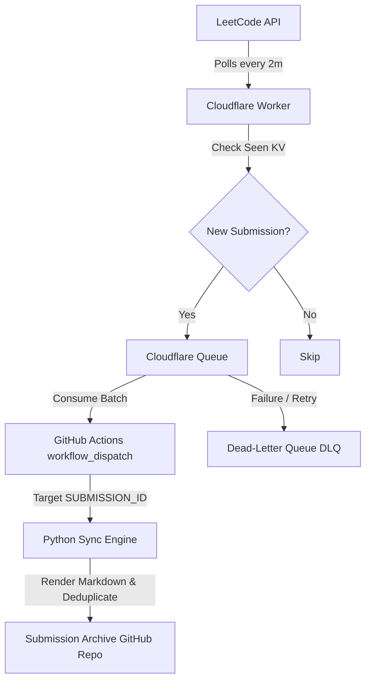

# LeetCode Cloud Sync 🚀

> Automatically save your LeetCode submissions to GitHub — from any device, without keeping a computer on.

[](https://github.com/kaviyack/leetcode-cloud-sync/actions/workflows/leetcode-sync.yml)
[](LICENSE)
[](https://www.python.org/)
[](https://workers.cloudflare.com/)

---

**LeetCode Cloud Sync is not affiliated with or endorsed by LeetCode.**

---

## Table of contents

1. [What it does](#what-it-does)
2. [Architecture and event-driven flow](#architecture-and-event-driven-flow)
3. [Repository architecture: one repo vs. two repos](#repository-architecture-one-repo-vs-two-repos)
4. [Technology stack](#technology-stack)
5. [Supported configuration options](#supported-configuration-options)
6. [Prerequisites](#prerequisites)
7. [Fork or clone the project](#fork-or-clone-the-project)
8. [Configure your LeetCode account](#configure-your-leetcode-account)
9. [Configure the destination repository](#configure-the-destination-repository)
10. [Add GitHub Actions secrets and variables](#add-github-actions-secrets-and-variables)
11. [Enable the workflow and run a manual sync](#enable-the-workflow-and-run-a-manual-sync)
12. [Inspect workflow logs safely](#inspect-workflow-logs-safely)
13. [Cloudflare Worker setup (optional event-driven architecture)](#cloudflare-worker-setup-optional-event-driven-architecture)
14. [Difficulty folders and timestamped files](#difficulty-folders-and-timestamped-files)
15. [How duplicate submissions are handled](#how-duplicate-submissions-are-handled)
16. [Run tests locally](#run-tests-locally)
17. [Troubleshooting](#troubleshooting)
18. [Security and privacy](#security-and-privacy)
19. [Contributing and reporting vulnerabilities](#contributing-and-reporting-vulnerabilities)
20. [Disable scheduled synchronization](#disable-scheduled-synchronization)
21. [Running locally with Windows Task Scheduler](#running-locally-with-windows-task-scheduler)
22. [License and related project](#license-and-related-project)

---

## What it does

LeetCode Cloud Sync is an automated synchronization system that detects accepted LeetCode submissions and commits them directly into a GitHub repository as clean Markdown files.

Because it runs in the cloud (via GitHub Actions and Cloudflare Workers), synchronization works regardless of which device you submitted from — phone, laptop, or tablet. No browser extension required. No local machine needed to stay online.

| Feature | Browser Extension | LeetCode Cloud Sync |
|---|---|---|
| Requires your device to be on | Yes | **No** |
| Works from any device (phone/tablet) | No | **Yes** |
| Runs unattended | No | **Yes** |
| Stores solutions in GitHub | Varies | **Yes** |
| Open source and auditable | Varies | **Yes** |

---

## Architecture and event-driven flow



### Core Components
- **Cloudflare Worker**: Polling engine running on Cron triggers (`*/2 * * * *`).
- **Cloudflare KV**: Durable store tracking seen submission IDs (`seen:<submissionId>`).
- **Cloudflare Queues & DLQ**: Reliable message queue with exponential backoff retries and Dead-Letter Queue fallback.
- **GitHub Actions**: Automated runner triggered via `workflow_dispatch` with target `SUBMISSION_ID`.
- **Python Sync Engine**: Fetches submission details, renders structured Markdown, and commits to [kaviyack/LEETCODE-SUBMISSIONS](https://github.com/kaviyack/LEETCODE-SUBMISSIONS).

---

## Technology stack

- **Language**: Python 3.11+, TypeScript
- **Cloudflare**: Cloudflare Workers, Cloudflare KV, Cloudflare Queues, Cron Triggers
- **CI/CD**: GitHub Actions (`workflow_dispatch`, scheduled cron)
- **APIs**: LeetCode GraphQL API, GitHub REST API (Contents & Actions)
- **Testing**: Pytest (Python), Vitest (TypeScript)

---

## Repository architecture: one repo vs. two repos

You can choose either setup:

### Option A — Single repository (simplest)
Everything lives in one repository: the application source code and your solutions.
- No extra token required (`GITHUB_TOKEN` is automatically available).
- Solutions are committed alongside the application code.

### Option B — Separate submissions repository (recommended)
| Repository | Contents |
|---|---|
| `YOUR_USERNAME/leetcode-cloud-sync` | Application source, tests, CI, documentation |
| `YOUR_USERNAME/leetcode-submissions` | Your generated solution Markdown files only |

Benefits:
- Clean separation between tool source code and personal solutions.
- Contributors to the tool do not see your solutions.
- You can make the submissions repo public or private independently.

> **Public repository warning:** Any solution committed to a public GitHub repository is visible to everyone, including future employers and other LeetCode users. If you want privacy, make your submissions repository private.

---

## Supported configuration options

### Configuration reference

| Variable | Type | Required | Purpose |
|---|---|---|---|
| `LEETCODE_USERNAME` | Variable | Yes | Your LeetCode username |
| `LEETCODE_SESSION` | Secret | Yes | Browser session cookie (`LEETCODE_SESSION`) |
| `LEETCODE_CSRF_TOKEN` | Secret | Yes | CSRF token cookie (`csrftoken`) |
| `GITHUB_TOKEN` | Secret | Yes | GitHub token with Contents write permission |
| `SUBMISSIONS_TOKEN` | Secret | Mode B only | Fine-grained PAT for cross-repo writes |
| `DESTINATION_REPO` | Variable | Yes | Destination repo (`owner/repo`) |
| `GITHUB_BRANCH` | Variable | No | Target branch (default: `main`) |
| `SOLUTIONS_ROOT` | Variable | No | Solutions directory (default: `solutions`) |
| `SYNC_MODE` | Variable | No | `accepted` or `all` (default: `accepted`) |
| `FETCH_LIMIT` | Variable | No | Max submissions per run (default: `20`) |
| `LOG_LEVEL` | Variable | No | Log level (`INFO`, `DEBUG`, etc.) |

### Where each variable belongs

| Variable | GitHub Actions secrets | GitHub Actions variables | Local `.env` |
|---|---|---|---|
| `LEETCODE_SESSION` | Yes | No | Yes (never commit) |
| `LEETCODE_CSRF_TOKEN` | Yes | No | Yes (never commit) |
| `SUBMISSIONS_TOKEN` | Yes | No | Yes (never commit) |
| `GITHUB_TOKEN` | Auto-provided | No | Yes (fine-grained PAT) |
| `LEETCODE_USERNAME` | No | Yes | Yes |
| `DESTINATION_REPO` | No | Yes | Yes |
| `GITHUB_BRANCH` | No | Yes | Yes |
| `SOLUTIONS_ROOT` | No | Yes | Yes |
| `SYNC_MODE` | No | Yes | Yes |
| `FETCH_LIMIT` | No | Yes | Yes |
| `LOG_LEVEL` | No | Yes | Yes |

---

## Prerequisites

- A [GitHub account](https://github.com).
- A [LeetCode account](https://leetcode.com).
- Python 3.11+ (for local development).
- Node.js & Wrangler CLI (optional, for Cloudflare Worker deployment).

---

## Fork or clone the project

### 1. Fork the repository
Click **Fork** on [github.com/kaviyack/leetcode-cloud-sync](https://github.com/kaviyack/leetcode-cloud-sync).

### 2. Clone locally (for development or testing)
```bash
git clone https://github.com/kaviyack/leetcode-cloud-sync.git
cd leetcode-cloud-sync
python -m venv .venv
source .venv/bin/activate   # Windows: .venv\Scripts\activate
pip install -r requirements.txt
```

Copy the example environment file and fill in your values:

```bash
cp .env.example .env
# Edit .env — do NOT commit it
```

---

## Configure your LeetCode account

The tool accesses LeetCode's GraphQL API using your browser session cookies. These are required to retrieve submission source code.

### How to get your session cookies

1. Log in to [leetcode.com](https://leetcode.com) in your browser.
2. Open **DevTools**:
   - Chrome/Edge: `F12` → **Application** tab → **Storage** → **Cookies** → `leetcode.com`
   - Firefox: `F12` → **Storage** tab → **Cookies** → `https://leetcode.com`
3. Find the cookie named `LEETCODE_SESSION` and copy its value.
4. Find the cookie named `csrftoken` and copy its value.

> **These cookies are equivalent to your LeetCode password.** Anyone with these values can access your account. Treat them as secrets. Do not paste them into source files, README files, issue comments, or any public place.

Session cookies typically last weeks but expire when you log out, change your password, or LeetCode invalidates them.

---

## Configure the destination repository

### Option A — Same repository
No extra steps needed. The built-in `GITHUB_TOKEN` has write access to the current repository automatically. Set `DESTINATION_REPO` to your repository name (e.g., `YOUR_USERNAME/leetcode-cloud-sync`) or leave it unset — the workflow defaults to the current repository.

### Option B — Separate submissions repository

#### Step 1: Create the submissions repository
1. Go to [github.com/new](https://github.com/new).
2. Create a repository named `leetcode-submissions` (or any name you prefer).
3. Set visibility: **Public** or **Private**.
4. Initialize it with a README so the `main` branch exists.

#### Step 2: Create a fine-grained personal access token (PAT)
The built-in `GITHUB_TOKEN` cannot write to a different repository. You need a PAT:
1. Go to **GitHub → Settings → Developer settings → Personal access tokens → Fine-grained tokens**.
2. Click **Generate new token**.
3. Set:
   - **Token name**: `leetcode-submissions-write`
   - **Repository access**: **Only select repositories** → select `leetcode-submissions`
4. Under **Permissions → Repository permissions**:
   - **Contents**: **Read and write**
5. Click **Generate token** and copy the value immediately.

#### Step 3: Add the PAT as a secret in leetcode-cloud-sync
In `YOUR_USERNAME/leetcode-cloud-sync`:
**Settings → Secrets and variables → Actions → New repository secret**
- `SUBMISSIONS_TOKEN`: The fine-grained PAT from Step 2.

---

## Add GitHub Actions secrets and variables

In `YOUR_USERNAME/leetcode-cloud-sync`:

### Secrets
**Settings → Secrets and variables → Actions → Secrets → New repository secret**
- `LEETCODE_SESSION`: Your `LEETCODE_SESSION` cookie value
- `LEETCODE_CSRF_TOKEN`: Your `csrftoken` cookie value
- `SUBMISSIONS_TOKEN`: Your fine-grained PAT (Mode B only)

### Variables
**Settings → Secrets and variables → Actions → Variables → New repository variable**
- `LEETCODE_USERNAME`: Your LeetCode username
- `DESTINATION_REPO`: Destination repo in `owner/repo` format
- `SYNC_MODE`: `accepted` or `all` (default: `accepted`)
- `GITHUB_BRANCH`: `main` (optional)
- `SOLUTIONS_ROOT`: `solutions` (optional)
- `FETCH_LIMIT`: `20` (optional)
- `LOG_LEVEL`: `INFO` (optional)

### Workflow permissions (Mode A only)
If writing to the same repository: **Settings → Actions → General → Workflow permissions → Read and write permissions** → Save.

---

## Enable the workflow and run a manual sync

1. Go to the **Actions** tab of `YOUR_USERNAME/leetcode-cloud-sync`.
2. If prompted, click **I understand my workflows, go ahead and enable them**.
3. Select **LeetCode Cloud Sync** from the left sidebar.
4. Click **Run workflow** → **Run workflow** to trigger a one-time manual sync.

---

## Inspect workflow logs safely

1. Go to the **Actions** tab.
2. Click the most recent workflow run.
3. Click the **Sync LeetCode Submissions** job and expand **Run synchronization**.

The application never logs session cookies, CSRF tokens, or tokens.

---

## Cloudflare Worker setup (optional event-driven architecture)

To achieve automatic cloud synchronization with scheduled polling approximately every two minutes:
1. Install Wrangler CLI:
   ```bash
   npm install -g wrangler
   wrangler login
   ```
2. Configure `worker/wrangler.toml` with your KV Namespace ID (`d2fc1d81ecbb48afba1f145a56feaecf`).
3. Set required worker secrets and variables:
   ```bash
   wrangler secret put LEETCODE_USERNAME
   wrangler secret put LEETCODE_SESSION
   wrangler secret put LEETCODE_CSRF_TOKEN
   wrangler secret put GITHUB_TOKEN
   wrangler secret put GITHUB_REPO     # e.g., "your-username/leetcode-cloud-sync"
   ```
4. Create both the main queue and dead-letter queue (DLQ):
   ```bash
   wrangler queues create leetcode-submission-events
   wrangler queues create leetcode-submission-events-dlq
   ```
5. Deploy the worker and verify:
   ```bash
   cd worker
   npm install
   wrangler deploy
   # Verify health endpoint:
   curl https://leetcode-cloud-sync-worker.<your-subdomain>.workers.dev/health
   ```

---

## Difficulty folders and timestamped files

Solutions are stored under the `solutions/` directory in the destination repository:
```
solutions/
├── easy/
│   └── 0001-two-sum/
│       └── 20261031_1200_python3_12345678.md
├── medium/
├── hard/
└── unknown/
```

**Filename format:** `<YYYYMMDD>_<HHMM>_<language>_<submission_id>.md`

Each file contains problem number, title, difficulty, topic tags, language, submission ID, UTC timestamp, status, runtime, memory usage, and full source code.

---

## How duplicate submissions are handled

The deduplication state (`.leetcode_sync_state.json`) tracks synced submission IDs. Multiple attempts, different languages, or resubmissions are preserved without overwriting existing files.

---

## Run tests locally

```bash
# Python tests (138 tests)
python -m pytest tests/ -v

# TypeScript worker tests (5 tests)
cd worker && npm install && npx vitest run
```

---

## Troubleshooting

- **Authentication failed / 403**: `LEETCODE_SESSION` has expired. Re-login and update the secret.
- **403 when writing to repo**: Ensure `SUBMISSIONS_TOKEN` has Contents `Read and write` permission on the destination repository.
- **No new files appear**: Check if submissions were already synced or increase `FETCH_LIMIT`.
- **submissionList returned null**: Refresh both `LEETCODE_SESSION` and `LEETCODE_CSRF_TOKEN`.
- **Rate limited (HTTP 429)**: Reduce `FETCH_LIMIT`.

---

## Security and privacy

- **Public repository = public solutions.** Use a private submissions repository if you want privacy.
- Secrets are encrypted at rest in GitHub Actions and never printed in logs.
- Session cookies expire periodically and require manual refresh.

---

## Contributing and reporting vulnerabilities

See [CONTRIBUTING.md](CONTRIBUTING.md) for contribution guidelines. For security vulnerabilities, see [SECURITY.md](SECURITY.md).

---

## Disable scheduled synchronization

To pause syncing: go to **Actions → LeetCode Cloud Sync** → `...` → **Disable workflow**.
To stop permanently: delete `.github/workflows/leetcode-sync.yml`.

---

## Running locally with Windows Task Scheduler

If you prefer running the background watcher locally on Windows:
1. Configure your credentials securely in a local `.env` file.
2. Register the scheduled task at logon by running:
   ```powershell
   .\scripts\setup-task.ps1
   ```
3. View logs at `logs/watcher.log`.
4. To uninstall:
   ```powershell
   .\scripts\uninstall-task.ps1
   ```
See [docs/windows-task-scheduler.md](docs/windows-task-scheduler.md) for details.

---

## License and related project

Distributed under the MIT License. See [LICENSE](LICENSE) for details.

- **Main Sync Engine**: [kaviyack/leetcode-cloud-sync](https://github.com/kaviyack/leetcode-cloud-sync)
- **Submission Archive**: [kaviyack/LEETCODE-SUBMISSIONS](https://github.com/kaviyack/LEETCODE-SUBMISSIONS)
